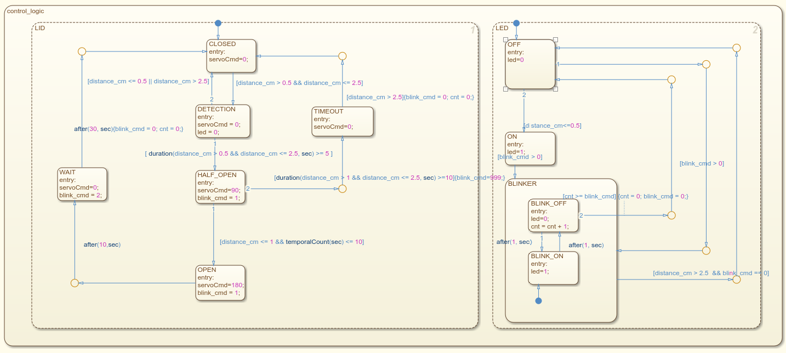
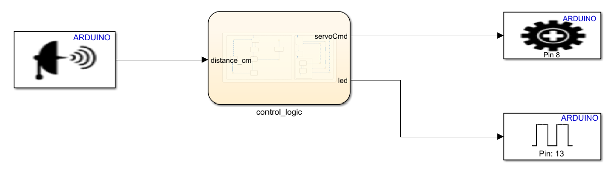
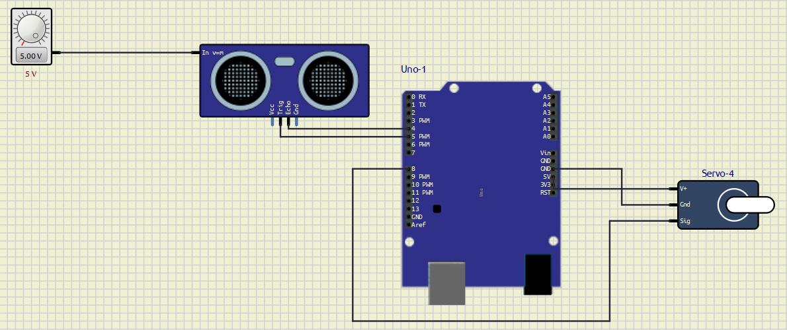
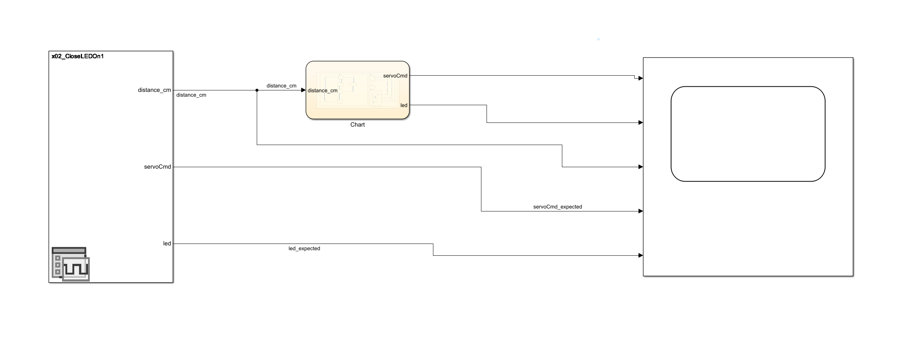
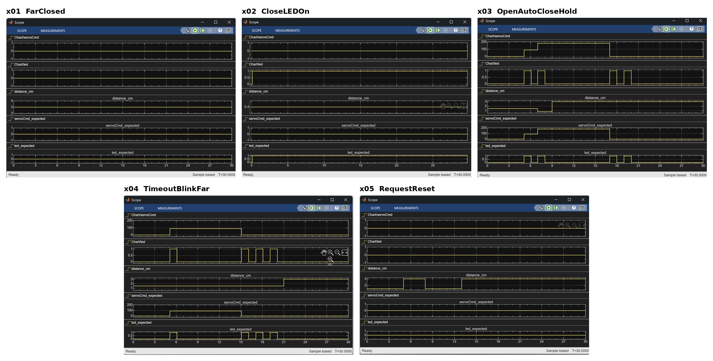

# Smart Bin: Stateflow Controller for Arduino

A smart rubbish bin that opens its lid when a hand approaches. The controller is designed as a **Stateflow** state machine from a set of written requirements, verified in a **Simulink test harness** against five test scenarios, turned into **Arduino Uno firmware** by code generation, and run on a virtual Uno in **SimulIDE** with an HC-SR04 ultrasonic sensor and a servo.

Model-Based Software Design (Grade: 27/30), Politecnico di Torino, A.Y. 2025/26.

<p align="center">
  
</p>

## How it works

An HC-SR04 ultrasonic sensor measures the distance `distance_cm` to the hand every 0.1 s. A servo moves the lid (`servoCmd` = 0 closed, 90 half open, 180 open) and the on-board LED (pin 13) shows the status: off, on, or blinking with a 2 s period.

The chart has two state machines running in parallel:

**LID**

| State | Lid | Entered when | Requirement |
|---|---|---|---|
| CLOSED | 0 | start, or the hand moves away (> 2.5) | Req 11, 12 |
| DETECTION | 0 | the hand is between 0.5 and 2.5 | Req 14 |
| HALF_OPEN | 90 | the hand has stayed between 0.5 and 2.5 for 5 s; LED blinks once | Req 15 |
| OPEN | 180 | the hand comes within 1 during the first 10 s of half-open; LED blinks once | Req 16a |
| WAIT | 0 | 10 s after opening: the lid closes (LED blinks twice) and the controller holds the initial condition for 30 s | Req 16b, 16c |
| TIMEOUT | 0 | the hand stayed between 1 and 2.5 for more than 10 s of half-open; the LED blinks until it moves away (> 2.5) | Req 17 |

**LED:** off by default, on while something is at 0.5 or closer (Req 13), and blinking as many times as the LID machine requests (Req 9).

## From model to hardware

**Deployment model** (`controller_auno.slx`): the same chart between the Arduino blocks: Ultrasonic Sensor (Trig pin 5, Echo pin 4), Standard Servo Write (pin 8) and Digital Output (pin 13, LED).

<p align="center">
  
</p>

**Simulation on a virtual Arduino** (`simulide/`): the firmware generated from the deployment model (`controller_auno.hex`) runs on a virtual Uno in SimulIDE. The voltage source sets the distance seen by the sensor (1 V = 1 m).

<p align="center">
  
</p>

## Testing

The harness (`smart_bin_harness.slx`) feeds a distance profile from a Signal Editor into the chart and plots the chart's outputs next to the expected ones. The five scenarios in `testcase.mat` were provided with the lab and define the expected behaviour.

<p align="center">
  
</p>

| Scenario | distance_cm profile | Expected behaviour | Result |
|---|---|---|---|
| x01_FarClosed | 3 throughout | lid closed, LED off |  pass |
| x02_CloseLEDOn | 0.4 throughout | LED on, lid closed |  pass |
| x03_OpenAutoCloseHold | 1.5, then 0.8 at 7 s, 3 from 9 s | half open at 5 s, open at 7 s, closes at 17 s and holds |  pass |
| x04_TimeoutBlinkFar | 1.5 until 21 s, then 3 | half open at 5 s, timeout at 15 s, LED blinks until the hand moves away |  pass |
| x05_RequestReset | 1.5 and 3 alternating; leaves exactly at the 5 s limit, twice | lid never opens, detection resets |  pass |

Scope results for all five scenarios: in each plot the chart's actual outputs are on top and the expected outputs at the bottom.

<p align="center">
  
</p>

`tests/run_tests.m` runs every scenario automatically and prints PASS/FAIL per scenario, comparing the chart outputs with the expected signals (±0.25 s at switching instants).

## Repository layout

```
models/
  control_logic.slx       Stateflow controller
  controller_auno.slx     deployment model with the Arduino blocks
tests/
  smart_bin_harness.slx   test harness
  testcase.mat            five test scenarios (inputs + expected outputs)
simulide/
  smartbin.sim1           virtual circuit
  controller_auno.hex     firmware generated from controller_auno.slx
docs/media/               screenshots
```

## Running it

**Models:** MATLAB R2025b with Simulink, Stateflow and the Simulink Support Package for Arduino Hardware.
- Controller: open `models/control_logic.slx`.
- Tests: open the `tests` folder in MATLAB, then open `smart_bin_harness.slx`, pick a scenario in the Signal Editor and run it.

**Firmware on hardware:** open `models/controller_auno.slx`, then Hardware → Build, Deploy & Start with an Arduino Uno connected.

**Without MATLAB:** open `simulide/smartbin.sim1` in SimulIDE 1.1.0, keeping `controller_auno.hex` in the same folder, and start the simulation. Turn the voltage source to change the distance (1 V = 1 m).

## Note

The requirements and the scenarios were provided with the lab assignments; the lab texts themselves are not included here.
